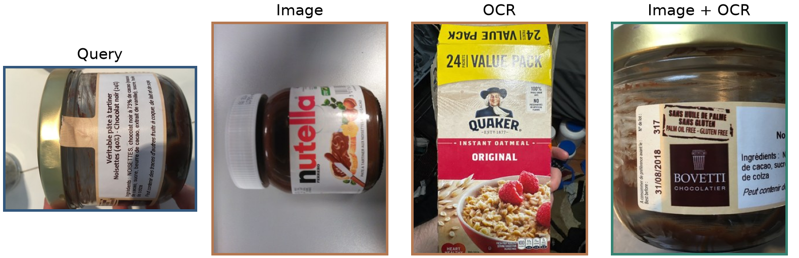

# Grocery Product Finder

[Try the live upload and recorded cases](https://martaforjaz.github.io/grocery-finder/).

A photo of a cereal box can be enough to tell you the brand, yet leave you guessing between two nearly identical variants. That matters when adding an item to a catalog. Its size or recipe might differ even though the boxes look alike, and the barcode may be on a side you cannot see.

I built Grocery Product Finder to see whether reading the packaging could help visual search identify the right variant. It compares image similarity with OCR and their combined ranking. Details like a product name or pack size can help separate similar candidates. When the evidence is weak, the demo asks for a clearer photo or the barcode. If the barcode is already visible, you can open the corresponding Open Food Facts record directly from the demo.


## Evaluation

| Method | Top 1 | Top 3 |
| --- | ---: | ---: |
| MobileNetV3 image similarity | 37/180 | 52/180 |
| RapidOCR + catalog token matching | 51/180 | 85/180 |
| Image + OCR | 62/180 | 96/180 |



The recorded example queries **Véritable pâte à tartiner noisettes chocolat noir**. Image ranking put **Pâte à tartiner aux noisettes et au cacao** first, and fusion put **Véritable pâte à tartiner noisettes chocolat noir** first. Each result card exposes the variant and its barcode. The demo also includes an absent-product query.

The snapshot contains **300 products** (232 cereals and 68 chocolate spreads) with distinct source uploads per barcode. There are 240 products in the gallery. 90 queries were reserved for calibration, and the final test contains 180 known and 30 absent-product queries. 79 pairs use a second upload explicitly tagged as a front photo. Other query photos may show a different side of the package. Identical processed images and pairs with matching upload timestamps were excluded.

The threshold accepted **2/210** test queries. Of these, **2 were incorrect**, including **0 products absent from the gallery**. Accepted counts measure coverage and incorrect accepts measure the risk of applying the threshold. This fixed snapshot represents only these categories and the source images selected by the ingestion policy. [Raw metrics](metrics.json) · [Test rankings and OCR](predictions.json)

## Method and reproduction

1. Normalize pretrained MobileNetV3 pooled embeddings and rank by cosine similarity.
2. Match normalized tokens extracted from the query photo against product name, brand and quantity, downweighting tokens that recur across the catalog.
3. Fuse the two scores with a fixed 55% vision / 45% OCR weight. Calibrate a separate threshold on the five calibration queries.

The catalog and query images, their upstream URLs and contributors are included in the [manifest](site/manifest.json). Python evaluation uses RapidOCR. The browser uses the same MobileNet ONNX weights and scoring approach with Tesseract.js English OCR. Its upload results have no benchmark claim and always require user verification.

```sh
pip install -r requirements.txt
python evaluate.py
python -m http.server 8776 --directory site
```

Open http://127.0.0.1:8776. The published benchmark images are included, so evaluation requires no catalog download. To refresh from the same source, run `python parquet_candidates.py` and `python ingest.py --parquet --target 300`. This uses the official Open Food Facts Parquet mirror and image archive. Run `python render_decision.py` after evaluation to regenerate the comparison figure. Open Food Facts changes over time; the committed snapshot reproduces the reported experiment.

## Attribution

Product database records come from [Open Food Facts](https://world.openfoodfacts.org/) under ODbL and the Database Contents License. Photos are attributed per image in the demo and in the manifest. The resized and EXIF-oriented images retain the [CC BY-SA 3.0 licence](https://creativecommons.org/licenses/by-sa/3.0/). See the [Open Food Facts reuse documentation](https://openfoodfacts.github.io/documentation/docs/Product-Opener/api/tutorials/license-be-on-the-legal-side/). The visual encoder is exported from [Torchvision MobileNetV3-Small](https://docs.pytorch.org/vision/stable/models/generated/torchvision.models.mobilenet_v3_small.html).

The evaluation figure follows the typography and axis conventions in [figures4papers](https://github.com/ChenLiu-1996/figures4papers).

## Batch catalog review

Add up to 30 photographs, select a file to run the three rankings, and enter the verified barcode. Export the confirmed rows as CSV. The application keeps the review session in the current browser tab. The benchmark evaluates retrieval accuracy; reviewer time savings have yet to be measured.
