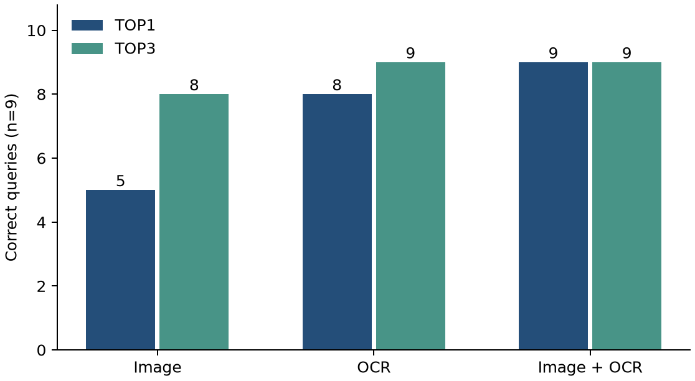

# Grocery Product Finder

[Try the live upload and recorded cases](https://martaforjaz.github.io/grocery-finder/).

Find the exact variant of an item when the front of its package is the only clue. The demo ranks catalog candidates from image features, text read from the package, and their combination. Live uploads run in the browser and present candidates for barcode verification.



## Pilot results

| Method | Top 1 | Top 3 |
| --- | ---: | ---: |
| MobileNetV3 image similarity | 5/9 | 8/9 |
| RapidOCR + catalog token matching | 8/9 | 9/9 |
| Image + OCR | 9/9 | 9/9 |

In the muesli example, image similarity ranks Country Crisp first. Recognized packaging text moves the exact Special Muesli variant to first place in the combined ranking. The demo also shows a query for a barcode outside the catalog.

The pilot uses **16 Open Food Facts products** (14 cereals, two chocolate spreads) with two distinct uploads per barcode. The search catalog contains 12 products. An independent query photo was reserved for each product, with five queries used to calibrate the decision threshold. The final test contains nine known and two absent-product queries. Ten product pairs use an alternate image explicitly tagged as front packaging; other query uploads may show a different side. Identical processed image pairs and pairs with matching upload timestamps are excluded. This small convenience sample is suitable for demonstrating the approach and its failure modes.

On the 11 test queries, the threshold accepted two, both correct. It rejected or deferred the other nine, including both absent products. This is a conservative exploratory threshold, without evidence of generalization beyond these queries. [Raw metrics](metrics.json) · [Test rankings and OCR](predictions.json)

## Method and reproduction

1. Normalize pretrained MobileNetV3 pooled embeddings and rank by cosine similarity.
2. Match normalized tokens extracted from the query photo against product name, brand and quantity, downweighting tokens that recur across the catalog.
3. Fuse the two scores with a fixed 55% vision / 45% OCR weight. Calibrate a separate threshold on the five calibration queries.

The catalog and query images, their upstream URLs and contributors are included in the [manifest](site/manifest.json). Python evaluation uses RapidOCR. The browser uses the same MobileNet ONNX weights and scoring approach with Tesseract.js English OCR. Its upload results have no benchmark claim and always require user verification.

```sh
pip install -r requirements.txt
python evaluate.py
python -m http.server 8776 --directory site
```

Open http://127.0.0.1:8776. The published benchmark images are included, so evaluation requires no catalog download. For a fresh sample, run python ingest.py to fetch the two Open Food Facts category searches and download new image pairs. Open Food Facts changes over time; the committed snapshot reproduces the reported experiment.

## Attribution

Product database records come from [Open Food Facts](https://world.openfoodfacts.org/) under ODbL and the Database Contents License. Photos are attributed per image in the demo and in the manifest. The resized and EXIF-oriented images retain the [CC BY-SA 3.0 licence](https://creativecommons.org/licenses/by-sa/3.0/). See the [Open Food Facts reuse documentation](https://openfoodfacts.github.io/documentation/docs/Product-Opener/api/tutorials/license-be-on-the-legal-side/). The visual encoder is exported from [Torchvision MobileNetV3-Small](https://docs.pytorch.org/vision/stable/models/generated/torchvision.models.mobilenet_v3_small.html).
